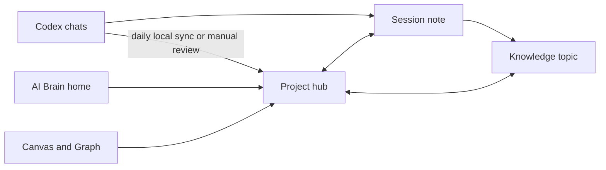

# Architecture

This repository is an Obsidian vault, not a server application.

`AI Brain.md` links to six project hubs. Each hub records a project purpose and current known state. Knowledge notes synthesise durable topics and link to the sessions that support them. Session notes preserve dated source outcomes, evidence and limitations. Ordinary Obsidian wikilinks provide navigation and backlinks.

`.obsidian/graph.json` groups notes by project folder. `.obsidian/snippets/ai-brain-projects.css` colours headings, callouts, project links and folder navigation from a project's `cssclasses` property. `AI Brain Map.canvas` provides the same palette spatially. Obsidian stores personal window layout in ignored workspace files.

The optional daily sync is a **Codex desktop automation outside this Git repository**. Its prompt and schedule are documented in `System/Automation Setup.md`. It reads accessible local Codex chats, compares full session IDs with existing private notes, then writes new or changed notes and coverage records into the local vault. Those generated records are ignored by Git. A fresh clone has no session data and does not create an automation on its own.

There is no database, API key, hosted service or community plugin in this starter.
